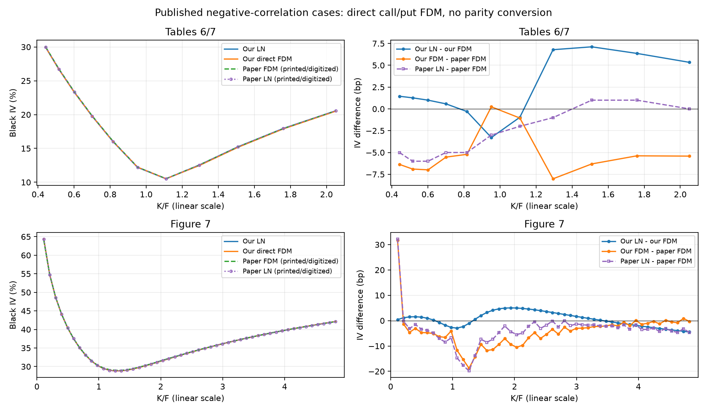

# AQF-darth-hedger

Replication of McGhee (2018), *An ANN Representation of the SABR Stochastic Volatility Model*, with β = 1 and normalized forward F₀ = 1.

## Layout

- `src/` — pricing, dataset generation, ANN training and calibration. Shared settings (data paths, maturity windows, ANN widths) are in `src/config.py`.
- `src/fdm.py` — Craig–Sneyd SABR PDE prices, with direct call/put pricing by default; parity remains an explicit legacy option.
- `src/fdm_experiment.py` — small FDM/LN/ANN comparison with separate space, time and domain checks.
- `AQF_S1_Hagan.ipynb` — Hagan dataset checks.
- `AQF_S2_ANN_Hagan.ipynb` — ANN results and calibration demonstration; training cells can launch training.
- `AQF_SABR_AllInOne.ipynb` — integration background and published-example checks.
- `figures/` — report figures and `tables.md`, regenerated by `figures/report_figures.py` without training.
- `results/` — result CSVs (calibration benchmark, integration and paper-example tables).
- `papers/` — McGhee (2018) and McGhee (2011).
- `data/datasets/` — Hagan and integration NPZ datasets.
- `data/models/` — trained weights and resumable checkpoints.
- `data/logs/` — per-model training logs and job output.
- `data/chunks/` — resumable integration-generation chunks (local only, not in Git).

The datasets, checkpoints and logs are committed, so the notebooks and figure script run straight after cloning. `wiki/` holds local project notes and is not in Git.

## Setup and checks

```sh
uv sync
uvx ruff check src figures *.ipynb               # lint
uv run python figures/report_figures.py
```

Figure regeneration requires the existing datasets and checkpoints in `data/`. It writes images and `tables.md` to `figures/` and CSVs to `results/`.

## Finite-difference validation

With dependencies installed in the active Python, run from the repository root:

```sh
python -m pytest -q
python -m src.fdm_paper --report-only
```

`src/fdm.py` implements the original Craig-Sneyd method with direct call/put
pricing. The retained comparison uses the 11 printed Tables 6/7 strikes and
50 digitized Figure 7 positions. Both cases have negative correlation.
The report-only command rebuilds the final linear-axis figure and error tables
from saved numerical solves; it does not train models or generate datasets.



To recompute both published cases and their grid/time/domain checks:

```sh
python -m src.fdm_paper
```

This writes `results/fdm_paper_direct/`. Use `--case tables` or `--case figure7`
to recompute one case. All finest estimates and any failed checks remain visible.
See [the direct comparison and reference limitations](docs/fdm_paper.md).
The final plot uses linear strike axes. `error_summary.csv` contains the compact
IV/price error tables; `comparison.csv` retains all 61 pointwise comparisons.
Paper LN is included in both the IV curves and paper LN minus paper FDM panels.
Figure 7 price references are explicitly identified as inferred from plotted IV.

Independent checks are retained in `src/fdm_independent.py` (forward-coordinate
Crank-Nicolson) and `src/fdm_mc_check.py` (conditional randomized QMC). Commands,
results and the unresolved sub-bp wing residual are documented in
[the discrepancy investigation](docs/fdm_diagnosis.md). One-off grid and payoff
experiments are [archived](archive/fdm/README.md); the
[code inventory](docs/fdm_review.md) explains the retained dependencies.

Historical pilot commands remain available because their modules also provide
shared convergence and domain-expansion helpers used by the final comparison:

```sh
python -m src.fdm_experiment
python -m src.fdm_refinement
```

These repeat eight historical cases and write `results/fdm_pilot/` and
`results/fdm_refined/`. They explicitly retain their earlier positive-rho
put-call-parity convention. They are separate from the final direct comparison;
see [the historical pilot documentation](docs/fdm.md).

## Training

Both maturity windows, **[1D, 1Y] and [1Y, 2Y]**, have completed Hagan pretraining and integration fine-tuning at widths 250, 500, 750 and 1000, with raw and transformed inputs.

| Stage/window | Raw checkpoint | Transformed checkpoint |
| --- | --- | --- |
| Hagan, 1D–1Y | `ann_{N}.pt` | `ann_log_{N}.pt` |
| Integration, 1D–1Y | `ann_{N}_ln.pt` | `ann_log_{N}_ln.pt` |
| Hagan, 1Y–2Y | `ann_{N}_1y2y.pt` | `ann_log_{N}_1y2y.pt` |
| Integration, 1Y–2Y | `ann_{N}_ln_1y2y.pt` | `ann_log_{N}_ln_1y2y.pt` |

Checkpoints in the table above live in `data/models/`. Training uses `data/datasets/hagan_{window}.npz` and `data/datasets/ln_parity_{window}.npz`. Each has 250,000 training and 50,000 test smiles. Integration labels are saved in resumable chunks in `data/chunks/ln_parity_parts/`.

Generation and training are explicit, potentially lengthy operations:

```sh
uv run python -m src.hagan                         # Hagan datasets, both windows
uv run python -m src.integration --workers 4      # integration datasets, both windows
uv run python -m src.train_ann hagan_1d_1y --log-inputs
uv run python -m src.train_ann ln_1d_1y --log-inputs
```

`src.train_ann` takes one of the runs `hagan_1d_1y`, `hagan_1y_2y`, `ln_1d_1y`, `ln_1y_2y` (defined in `RUNS`), optionally followed by widths (default 250 500 750 1000). The `ln_*` runs fine-tune the matching Hagan network. Omit `--log-inputs` for raw inputs. Completed checkpoints are skipped; interrupted training resumes.

## Calibration

`src.calibration` fits `(alpha, nu_1M, rho)` using bounded SLSQP and IV least squares. The current interface supports [1D, 1Y] and defaults to transformed N=750. It interpolates ANN outputs using cubic IV against strike; alternative interpolation rules remain research experiments.

```python
from src.calibration import Quotes, calibrate, load_ann

quotes = Quotes(maturity=0.5, forward=100.0,
                strikes=[95, 100, 105], ivs=[0.22, 0.20, 0.19])
result = calibrate(quotes, "ann", load_ann())
```

Maturity is in years, IVs are decimals, and strikes are absolute. The opt-in synthetic benchmark tests the pipeline; it is not market-data evidence:

```sh
uv run python -m src.calibration
```

Outputs go to `results/calibration.csv`.
